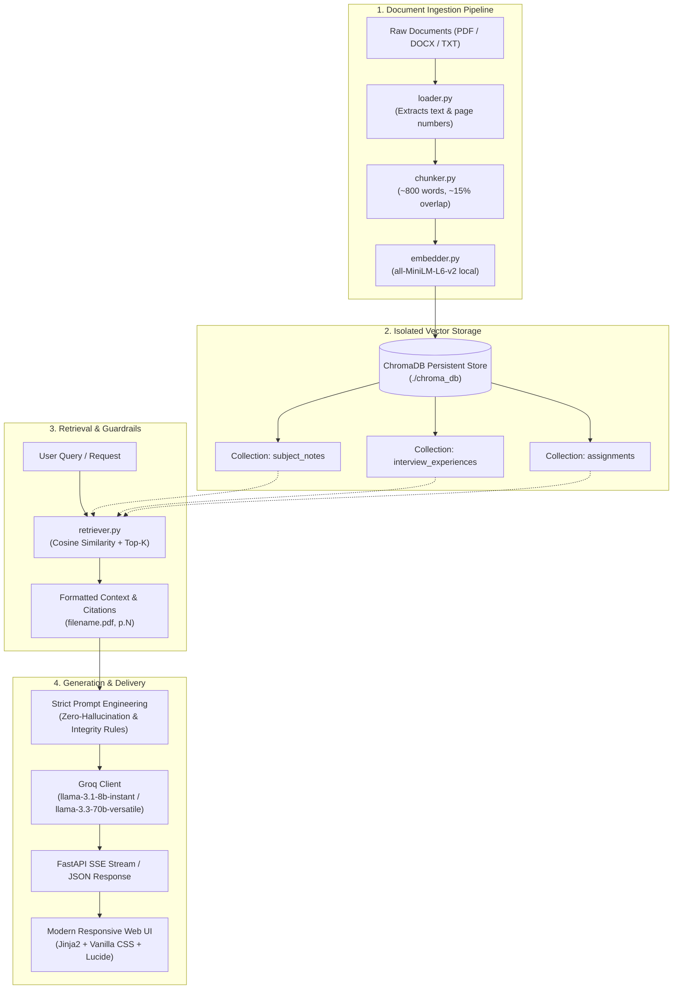

# 🎓 Placement Prep RAG Assistant

[](https://www.python.org/)
[](https://fastapi.tiangolo.com/)
[](https://www.trychroma.com/)
[](https://groq.com/)
[](https://huggingface.co/sentence-transformers/all-MiniLM-L6-v2)
[](LICENSE)

An end-to-end, multi-collection **Retrieval-Augmented Generation (RAG)** platform designed specifically for college students and tech aspirants preparing for placements, coding rounds, and technical interviews.

Unlike generic LLMs that hallucinate or provide surface-level advice, **Placement Prep RAG** grounds all generated answers, quizzes, flashcards, and interview advice strictly in your own uploaded university lecture notes, past company interview archives, and resumes — complete with page-level citations (`filename.pdf, p.N`), academic integrity guardrails, and real-time streaming.

---

## 🚀 Key Modules & Capabilities

| Module | Core Functionality | Primary Grounding Context |
| :--- | :--- | :--- |
| **📖 Notes Q&A** | Context-grounded Q&A with real-time SSE streaming, inline citations, and direct PDF viewing. | Academic Lecture Notes (`COLLECTION_NOTES`) |
| **🤖 AI Tutor** | Multi-level pedagogical masterclasses (Beginner / Intermediate / Advanced) breaking down core concepts into definitions, analogies, industrial applications, step-by-step logic, common pitfalls, and interview traps. | Academic Lecture Notes (`COLLECTION_NOTES`) |
| **📝 Quiz Generator** | Configurable assessment generator supporting MCQs, True/False, Fill in the Blanks, Short Answer, and Coding Concepts with instant auto-grading, answer explanations, and analytics logging. | Academic Lecture Notes (`COLLECTION_NOTES`) |
| **🧠 Active Recall Flashcards** | Generates digital front/back flip cards for spaced repetition and rapid concept review before exams or interview rounds. | Academic Lecture Notes (`COLLECTION_NOTES`) |
| **💼 Interview Prep** | Company-filtered interview Q&A exploring DSA trends, round structures, coding difficulty, and behavioral expectations. Features AI company research and direct interview experience logging. | Historical Interview Experiences (`COLLECTION_INTERVIEW`) |
| **📄 Resume-to-Question Mapper** | Deterministic keyword-based technical skill extractor (PDF/TXT) that generates targeted, past-interview-grounded questions for each detected skill without LLM hallucinations. | Candidate Resume & Interview Archives |
| **🛡️ Assignment Helper** | Conceptual breakdown, architecture planning, and pseudocode guidance with **academic integrity guardrails** that detect and block compilable code output. | Course & Lecture Material (`COLLECTION_ASSIGNMENTS`) |
| **📅 Intelligent Study Planner** | Personalized day-by-day study roadmap, weekly milestones, and active recall revision timelines customized by exam dates, weak subjects, and target company profiles. | Interview Experiences & User Inputs |
| **📊 Placement Analytics Dashboard** | Real-time tracking of study streaks, daily learning time, quiz scores, topics mastered, and an automated **Placement Readiness Score** with actionable AI recommendations. | System Event Logs (`data/analytics_logs.json`) |

---

## 🏛️ System Architecture



### Key Engineering Decisions
- **Multi-Collection Isolation**: Dedicated ChromaDB collections for lecture notes, company interview transcripts, and assignments ensure that interview advice never pollutes academic lecture queries and vice versa.
- **Local Embedding Computation**: High-performance local sentence embeddings (`sentence-transformers/all-MiniLM-L6-v2`) eliminate third-party embedding API costs, rate limits, and external network latency.
- **Auditable Page-Level Citations**: PDF extraction via `pdfplumber` retains physical page numbers, allowing answers to cite exact pages (`Operating_Systems.pdf, p.14`) and linking directly to an embedded PDF viewer.
- **Academic Integrity Guardrails**: The Assignment Helper enforces server-side AST and regular expression inspection (`contains_compilable_code`) to ensure students receive algorithmic intuition rather than direct copy-paste solutions.

---

## 📁 Repository Structure

```
placement-prep-rag/
├── config/
│   └── settings.py               # Central environment configurations & tunable constants
├── data/
│   ├── raw/
│   │   ├── notes/                # Lecture notes & textbooks (PDF, DOCX, TXT)
│   │   ├── interview_experiences/# Company interview archives & transcripts
│   │   ├── resumes/              # Candidate resumes for skill parsing
│   │   └── course_notes/         # Course-specific assignment materials
│   └── processed/                # Processed artifacts & cache
├── src/
│   ├── ingestion/
│   │   ├── loader.py             # Multi-format document parser (PDF, DOCX, TXT)
│   │   ├── chunker.py            # Word-based chunking with sliding window overlap
│   │   ├── pipeline.py           # End-to-end ingestion orchestrator
│   │   └── resume_parser.py      # Non-LLM regex and lexicon skill extractor
│   ├── embeddings/
│   │   └── embedder.py           # HuggingFace sentence-transformers wrapper
│   ├── vectorstore/
│   │   └── chroma_client.py      # ChromaDB client with collection lifecycle management
│   ├── retrieval/
│   │   └── retriever.py          # Similarity search, metadata filtering, and citation builder
│   ├── generation/
│   │   ├── llm_interface.py      # Abstract LLM provider base class
│   │   └── groq_client.py        # Groq Cloud API implementation (Sync & Streaming)
│   ├── modules/
│   │   ├── subject_qa.py         # Notes Q&A module with SSE streaming
│   │   ├── interview_qa.py       # Company interview preparation Q&A
│   │   ├── resume_mapper.py      # Resume skill mapping to historical interview questions
│   │   ├── assignment_helper.py  # Conceptual assignment advisor with integrity filters
│   │   ├── ai_tutor.py           # Structured multi-tier study concept masterclass
│   │   ├── quiz_generator.py     # Multi-format quiz generator & auto-evaluator
│   │   ├── flashcards.py         # Active recall digital flashcard generator
│   │   ├── study_planner.py      # Personalized exam & placement study schedule builder
│   │   └── analytics_dashboard.py# Streak tracker, readiness scoring, and logging
│   └── api/
│       └── main.py               # FastAPI application, REST endpoints, and template router
├── frontend/
│   ├── templates/                # Jinja2 HTML templates for all views
│   └── static/
│       ├── css/                  # Curated responsive dark-mode stylesheets
│       └── js/                   # Vanilla JavaScript controllers for each module
├── eval/
│   ├── evaluate.py               # Precision@k evaluation benchmark suite
│   └── test_questions.json       # Ground-truth test cases and expected keywords
├── scripts/
│   ├── ingest_all.py             # Batch ingestion utility for offline document indexing
│   ├── test_phase1.py            # Smoke test for core retrieval & embedding pipeline
│   └── test_groq_direct.py       # Groq Cloud API connectivity validation
├── notebooks/
│   └── 01_pipeline_test.ipynb    # Interactive pipeline exploration notebook
├── requirements.txt              # Production and development dependencies
├── .env.example                  # Environment configuration template
└── README.md
```

---

## 🛠️ Installation & Setup

### 1. Prerequisites
- **Python 3.10 or 3.11** is recommended (avoid Python 3.14+ as certain native C++ wheels for ChromaDB may not yet be precompiled).
- A free [Groq Cloud API Key](https://console.groq.com) for ultra-fast LLaMA model inference.

### 2. Clone the Repository
```bash
git clone https://github.com/SriSaiTeja2006/placement-prep-rag.git
cd placement-prep-rag
```

### 3. Create a Virtual Environment
```bash
# Windows (PowerShell)
py -3.11 -m venv .venv
.venv\Scripts\Activate.ps1

# Linux / macOS
python3 -m venv .venv
source .venv/bin/activate
```

### 4. Install Dependencies
```bash
pip install --upgrade pip
pip install -r requirements.txt
```

### 5. Configure Environment Variables
Copy `.env.example` to `.env`:
```bash
# Windows
copy .env.example .env

# Linux / macOS
cp .env.example .env
```

Open `.env` and configure your credentials:
```env
# Groq Cloud API Key (Required)
GROQ_API_KEY=gsk_your_actual_api_key_here

# Groq Model Selection (default: llama-3.1-8b-instant)
GROQ_MODEL=llama-3.1-8b-instant

# Embedding Model (runs locally, no API key required)
EMBEDDING_MODEL=all-MiniLM-L6-v2

# Chunking & Retrieval Parameters
CHUNK_SIZE=800
CHUNK_OVERLAP=120
TOP_K=5
CHROMA_PERSIST_DIR=chroma_db
```

---

## ⚡ Quickstart & Usage

### 1. Ingest Documents

You can upload documents directly from the Web UI or batch ingest existing files from the terminal:

1. Place your lecture notes (PDF/TXT/DOCX) in `data/raw/notes/`.
2. Place company interview experiences in `data/raw/interview_experiences/`.
3. Run the batch ingestion script:

```bash
python scripts/ingest_all.py
```

### 2. Launch the Application

Start the FastAPI application with Uvicorn:

```bash
# Recommended for development (watches only project code, ignores .venv)
uvicorn src.api.main:app --reload --reload-dir src --reload-dir config --reload-dir frontend --host 127.0.0.1 --port 8000

# Or standard run without auto-reload
uvicorn src.api.main:app --host 127.0.0.1 --port 8000
```

Once running, access:
- **Interactive Web Interface**: [http://127.0.0.1:8000](http://127.0.0.1:8000)
- **Interactive Swagger API Docs**: [http://127.0.0.1:8000/docs](http://127.0.0.1:8000/docs)
- **Redoc API Specification**: [http://127.0.0.1:8000/redoc](http://127.0.0.1:8000/redoc)

---

## 📊 Core API Endpoints

| Method | Endpoint | Description |
| :--- | :--- | :--- |
| `POST` | `/notes/upload` | Upload and index subject lecture notes into `COLLECTION_NOTES`. |
| `POST` | `/subject-qa` | Ask questions grounded in notes with SSE streaming response. |
| `POST` | `/tutor/explain` | Generate multi-section pedagogical concept breakdowns (streamed). |
| `POST` | `/quiz/generate` | Generate MCQs, True/False, or Fill-in-the-blank quizzes. |
| `POST` | `/flashcards/generate` | Generate active recall study flashcards from notes. |
| `POST` | `/interview-qa` | Ask company-filtered questions grounded in interview logs. |
| `POST` | `/interview/upload` | Upload company-tagged interview experiences. |
| `POST` | `/interview/paste` | Log raw interview feedback directly into the vector database. |
| `POST` | `/interview/research` | Autonomous LLM research for company interview patterns. |
| `POST` | `/resume/skills` | Deterministic keyword-based skill parsing from resumes (PDF/TXT). |
| `POST` | `/resume/questions` | Generate 3 targeted interview questions grounded in history for a skill. |
| `POST` | `/assignment/query` | Retrieve step-by-step algorithmic guidance without runnable code. |
| `POST` | `/study-plan/generate` | Generate a customized daily study schedule leading up to exams. |
| `GET`  | `/api/analytics` | Retrieve study streaks, test histories, and placement readiness score. |
| `GET`  | `/pdf/{filename}` | Serve indexed PDF files for in-browser citation verification. |

---

## 🧪 Retrieval Evaluation (Precision@k)

The project includes an automated evaluation benchmark that calculates the **Mean Precision@k** of the vector retrieval layer:

```bash
python eval/evaluate.py
```

### How It Works:
- Loads standardized placement queries from `eval/test_questions.json`.
- Queries the ChromaDB index for top-$k$ most similar chunks.
- Computes what fraction of the retrieved chunks contain key ground-truth technical concepts.
- Outputs precision scores per query and computes the aggregate benchmark score across collections.

---

## 💻 Tech Stack

- **Backend Framework**: [FastAPI](https://fastapi.tiangolo.com/) (Asynchronous endpoints, SSE streaming, Pydantic validation)
- **Vector Database**: [ChromaDB](https://www.trychroma.com/) (Persistent local vector storage, isolated collection schemas)
- **Embedding Model**: [HuggingFace sentence-transformers](https://huggingface.co/sentence-transformers/all-MiniLM-L6-v2) (`all-MiniLM-L6-v2`, 384-dimensional dense vectors)
- **LLM Inference**: [Groq Cloud](https://groq.com/) (`llama-3.1-8b-instant` / `llama-3.3-70b-versatile`)
- **Document Extractors**: [pdfplumber](https://github.com/jsvine/pdfplumber) (page-aware PDF parsing), Python XML parser (DOCX parsing)
- **Frontend Architecture**: Jinja2 Templates, Vanilla CSS Design System, Modern Glassmorphism UI, [Lucide Icons](https://lucide.dev/)
- **Evaluation**: Custom Precision@k evaluation harness

---

## 📜 License

Distributed under the **MIT License**. See [`LICENSE`](LICENSE) for complete details.